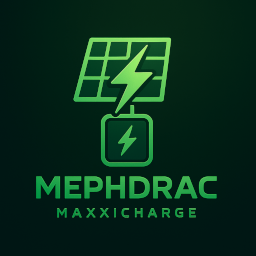

# MaxxiChargeConnect

[](https://github.com/mephdrac/MaxxiChargeConnect/releases)
[](LICENSE)
[](https://github.com/mephdrac/MaxxiChargeConnect/issues)
[](https://github.com/mephdrac/MaxxiChargeConnect/commits/main)

**MaxxiChargeConnect** ist eine quelloffene, lokal arbeitende Integration für [Home Assistant](https://www.home-assistant.io/), mit der sich **MaxxiCharge-Systeme von Maxxisun** überwachen und – abhängig von Gerät, Firmware und Kommunikationsweg – konfigurieren lassen.

Die Integration unterstützt sowohl die **CCU V1 per Webhook** als auch die **CCU V2 über MQTT**. Sie stellt Messwerte und Gerätestatus als Home-Assistant-Entitäten bereit und ermöglicht die Nutzung in Automationen, Diagrammen und im Energie-Dashboard.

> [!IMPORTANT]
> **MQTT-Firmware-Verfügbarkeit:** Die MQTT-Anbindung für CCU V2 ist in MaxxiChargeConnect ab **2.9.0** implementiert. **Maxxisun hat MQTT bislang nur für die CCU V2+ veröffentlicht.** Für die normale **CCU V2** ist die entsprechende Firmware-Funktion nach bisherigem Kenntnisstand noch in Planung. Die Unterstützung in dieser Integration bedeutet **nicht**, dass jede V2 bereits MQTT-Daten senden kann.

## Unterstützte Geräte und Kommunikationswege

| Gerät | Anbindung | Stand |
| --- | --- | --- |
| **CCU V1** | Lokaler HTTP-Webhook; ergänzende Konfigurationsabfragen über `maxxi.local` bzw. IP | Unterstützt |
| **CCU V2+** | MQTT | Unterstützt, sofern die entsprechende MQTT-Firmware verfügbar und eingerichtet ist |
| **CCU V2** | MQTT | In der Integration implementiert; die benötigte MQTT-Firmware ist von Maxxisun für die normale V2 noch nicht veröffentlicht |

Die verfügbaren Messwerte und Einstellungen unterscheiden sich nach CCU-Modell, Firmware und den tatsächlich gesendeten Daten. Nicht jede Entität steht bei jedem Gerät zur Verfügung.

## Funktionen

### CCU V1 – lokaler Webhook

- Empfang der Status- und Messdaten direkt in Home Assistant, ohne dass für den normalen lokalen Datenempfang eine externe Cloud erforderlich ist.
- Darstellung von unter anderem **PV-Leistung, Batterieleistung, Ladezustand (SOC), gespeicherter Energie (SoE), CCU-Ausgangsleistung und Netzleistung**.
- Anzeige von Geräteinformationen wie Firmware-Version, Geräte-ID, WLAN-Signalstärke und Betriebszeit, soweit von der Firmware geliefert.
- Energie- und Leistungsentitäten, beispielsweise für Netzbezug, Einspeisung und Erzeugung.
- Ergänzende Abfrage von Einstellungen über die lokale Geräteoberfläche beziehungsweise IP-Adresse, sofern die verwendete Firmware dies bereitstellt.
- **Winterbetrieb** und zugehörige Ladegrenzen sowie weitere verfügbare Steuerungsoptionen.
- **Optionaler lokaler Reverse-Proxy**, der eine Einbindung des Geräts in Home Assistant bei gleichzeitiger Weiterleitung ausgewählter Kommunikation ermöglichen kann. Die Cloud-Weiterleitung ist eine gesonderte Option und nicht Voraussetzung für den lokalen Betrieb.

### CCU V2 / V2+ – MQTT (neu in 2.9.0)

- Unterstützung von **MQTT-Telemetrie und MQTT-Discovery**.
- Zuordnung der empfangenen Werte zu bestehenden Home-Assistant-Entitäten, beispielsweise für PV, Batterie, Wechselrichter und Netzmessung.
- Auswertung von Geräte- und Batterieinformationen wie **SOC, Spannung, Strom und Leistung**, soweit über MQTT bereitgestellt.
- Unterstützung von über Discovery angekündigten Einstellungen und Steuerelementen, einschließlich **Zahlen, Auswahlfeldern und Schaltern**.
- Berücksichtigung von Gerätezuordnung, Verfügbarkeit, Statusmeldungen und Bestätigungen bei steuernden MQTT-Befehlen.
- **Externer MQTT-Broker** oder **integrierter MQTT-Broker** als alternative Betriebsarten.
- Diagnoseinformationen zur MQTT-Verbindung und zu empfangenen Daten.
- Mehrere CCUs können als separate Geräte eingebunden werden.

Die MQTT-Discovery-Meldungen des Geräts bestimmen, welche Einstellungen tatsächlich verfügbar sind. Die Integration kann keine Funktionen freischalten, die die Geräte-Firmware nicht anbietet.

### Home-Assistant-Integration

- Einrichtung und Neukonfiguration über die Home-Assistant-Oberfläche; **keine manuelle `configuration.yaml` erforderlich**.
- Geräte- und batteriebezogene Entitäten mit passenden Einheiten, Icons und Geräteklassen.
- Deutsche und englische Übersetzungen.
- Nutzung der Sensorwerte für Dashboards und Automationen.
- Unterstützung von Aktualisierung und Migration bestehender Konfigurationseinträge.

## Installation

### Home Assistant 2026.11 und neuer – Marketplace

Für Home Assistant **ab 2026.11** ist der **Marketplace** der vorgesehene Installationsweg.

1. Öffne in Home Assistant den Marketplace.
2. Suche nach **MaxxiChargeConnect**.
3. Installiere die Integration und starte Home Assistant bei entsprechender Aufforderung neu.
4. Gehe zu **Einstellungen → Geräte & Dienste → Integration hinzufügen** und wähle **MaxxiChargeConnect**.

Falls MaxxiChargeConnect in deinem Marketplace noch nicht angezeigt wird, prüfe die Verfügbarkeit des Eintrags beziehungsweise nutze die manuelle Installation.

### Ältere Home-Assistant-Versionen – HACS

Für ältere Home-Assistant-Versionen kann die Integration über **HACS** installiert werden:

1. Öffne **HACS**.
2. Füge bei Bedarf das Repository `https://github.com/mephdrac/MaxxiChargeConnect` als benutzerdefiniertes Integrations-Repository hinzu.
3. Installiere **MaxxiChargeConnect**.
4. Starte Home Assistant neu und füge die Integration unter **Einstellungen → Geräte & Dienste** hinzu.

> [!NOTE]
> Der Installationsweg sagt nichts darüber aus, ob eine ältere Home-Assistant-Version mit **2.9.0** kompatibel ist. Die vollständige Testsuite wurde für diese Version erfolgreich mit **Home Assistant 2026.11.1 / Python 3.14** ausgeführt. Für ältere Versionen ist die Kompatibilität gesondert zu prüfen.

### Manuelle Installation

1. Lade das Repository beziehungsweise das passende Release herunter.
2. Kopiere den Ordner `custom_components/maxxi_charge_connect` nach `<config>/custom_components/maxxi_charge_connect` deiner Home-Assistant-Installation.
3. Starte Home Assistant neu.
4. Füge **MaxxiChargeConnect** über **Einstellungen → Geräte & Dienste** hinzu.

## Einrichtung

### CCU V1

Bei der Einrichtung wählst du **CCU V1** und gibst die benötigten Gerätedaten an, insbesondere den **Gerätenamen**, die **Device-ID** und eine **Webhook-ID**.

Anschließend wird die CCU so konfiguriert, dass sie ihre Daten an den lokalen Home-Assistant-Webhook sendet. Die URL hat grundsätzlich dieses Format:

```text
http://HOME_ASSISTANT_HOST:8123/api/webhook/DEINE_WEBHOOK_ID
```

`HOME_ASSISTANT_HOST` muss für die CCU im lokalen Netzwerk erreichbar sein. Ersetze `DEINE_WEBHOOK_ID` durch die in der Integration eingerichtete Kennung. Verwende dafür eine ausreichend schwer zu erratende ID.

Je nach Firmware müssen in der Geräteoberfläche beziehungsweise über `maxxi.local` die Einstellungen für die Nutzung eines lokalen Servers und die API-Route gesetzt werden.

Optional können die Geräte-IP, der lokale Reverse-Proxy und weitere verfügbare Optionen konfiguriert werden. **Cloud-Weiterleitung ist optional**: Die passenden Einstellungen hängen davon ab, ob du ausschließlich lokale Daten empfangen oder zusätzlich die Hersteller-App weiterverwenden möchtest.

Ausführliche Anleitungen:

- [Konfiguration der Maxxi-CCU (`maxxi.local`)](https://github.com/mephdrac/MaxxiChargeConnect/wiki/B.2.1-Maxxi%E2%80%90CCU-(maxxi.local)-%E2%80%90-Konfiguration)
- [MaxxiChargeConnect konfigurieren](https://github.com/mephdrac/MaxxiChargeConnect/wiki/B.2.2-MaxxiChargeConnect-konfigurieren)
- [Weitere Installationshinweise](documentation/doc.md)

### CCU V2 / V2+ mit MQTT

1. Stelle sicher, dass deine CCU eine Firmware mit **MQTT-Unterstützung** besitzt. Derzeit betrifft das nach bekanntem Veröffentlichungsstand **CCU V2+**.
2. Richte die MQTT-Verbindung in der CCU gemäß den verfügbaren Herstelleroptionen ein.
3. Füge **MaxxiChargeConnect** als Integration hinzu und wähle **CCU V2** beziehungsweise die passende MQTT-Einrichtung.
4. Wähle den gewünschten MQTT-Betrieb: **vorhandener MQTT-Broker** oder **integrierter Broker**.
5. Trage die geräte- und verbindungsspezifischen Angaben ein. Falls du den internen Broker verwendest, sichere ihn mit geeigneten Zugangsdaten ab.
6. Prüfe in Home Assistant, ob Telemetrie- und Discovery-Nachrichten eintreffen und die Entitäten angelegt beziehungsweise aktualisiert werden.

**Wichtig:** Die Integration kann eine fehlende MQTT-Funktion in der Geräte-Firmware nicht ersetzen. Wenn deine normale CCU V2 noch keine MQTT-Einstellungen anbietet, muss zunächst die Freigabe durch Maxxisun erfolgen.

## Hinweise und bekannte Einschränkungen

### Firmware CCU V1

- Die Firmware-Stände **.44, .45, .46 und .48** werden unterstützt.
- Bei **.41** funktioniert der Webhook, die zusätzlichen über `maxxi.local` abrufbaren Informationen sind jedoch nur eingeschränkt verfügbar. Siehe [Issue #77](https://github.com/mephdrac/MaxxiChargeConnect/issues/77).
- Ältere Firmware-Stände unter **.41** werden nicht regulär unterstützt.
- In Firmware **.46** ist die CCU-Temperatur nicht in den gesendeten Daten enthalten; in **.48** steht sie wieder zur Verfügung.

### Berechnete Energie- und Verbrauchswerte

Die Entitäten für **Hausverbrauch** und **PV-Eigenverbrauch** sowie deren Energiezähler basieren teilweise auf berechneten Werten. Ihre Aussagekraft hängt von der Anlagenkonfiguration ab.

Wenn weitere PV-Anlagen, zusätzliche Speicher oder mehrere CCUs vorhanden sind, kann die Bilanz unvollständig oder irreführend sein. Aktiviere solche optionalen Sensoren daher nur, wenn die Berechnung zu deinem Aufbau passt.

### Netz, Broker und Sicherheit

- Lokale Kommunikation erfordert, dass die beteiligten Geräte die benötigten IP-Adressen und Ports erreichen können.
- Bei Nutzung eines externen Brokers muss die MQTT-Integration beziehungsweise Brokerverbindung in Home Assistant entsprechend eingerichtet sein.
- Verwende sichere Zugangsdaten für MQTT und schütze den Webhook vor unberechtigtem Zugriff.
- Stelle den integrierten MQTT-Broker oder lokale Webhook-Endpunkte nicht ungeschützt ins Internet.
- Ersetze eine Webhook-ID, die früher in einer Entität sichtbar war oder in Logs, Screenshots oder Foren geteilt wurde. Hinterlege die neue ID in Home Assistant und in der Webhook-URL auf der CCU.
- Der optionale lokale Cloud-Proxy auf TCP-Port 3001 prüft die konfigurierte Geräte-ID und die Quell-IP der CCU. Der Port gehört ins lokale Netz.
- Cloud-Optionen und Weiterleitungen sollten bewusst aktiviert werden; für eine rein lokale Nutzung sind sie nicht nötig.

## Was ist neu in Version 2.9.0?

Der Schwerpunkt dieses Releases ist die neue **CCU-V2-Anbindung über MQTT**. Dazu gehören die Verarbeitung von MQTT-Daten und Discovery-Meldungen, Geräte- und Batterieentitäten, Diagnosefunktionen sowie Optionen für externe und integrierte Broker.

Die bisherige Unterstützung für **CCU V1 per Webhook** bleibt erhalten. Version 2.9.0 ist damit keine Ablösung der V1-Integration, sondern eine Erweiterung auf die neuere Gerätegeneration.

Weitere Änderungen und Korrekturen findest du in den [GitHub Releases](https://github.com/mephdrac/MaxxiChargeConnect/releases).

### ⚠️ YAML-Migration ab Version 2.9.1 nicht mehr unterstützt

Mit **MaxxiChargeConnect v2.9.1** wird die Unterstützung für die Migration älterer YAML-basierter Konfigurationen (von Jörn R.) eingestellt.

Die bisherige Migrationsfunktion wurde vollständig entfernt und steht ab dieser Version nicht mehr zur Verfügung.

**Was bedeutet das für bestehende Nutzer?**

- Bereits über die Home-Assistant-Benutzeroberfläche eingerichtete Integrationen sind von dieser Änderung nicht betroffen.
- Bestehende Geräte und Entitäten bleiben erhalten.
- Eine Übernahme alter YAML-Konfigurationen wird nicht mehr unterstützt.
- Wer noch eine YAML-basierte Konfiguration verwendet, muss MaxxiChargeConnect über **Einstellungen → Geräte & Dienste** neu einrichten.

**Hinweis:** Diese Änderung betrifft ausschließlich die veraltete YAML-Migration. Die regulären Aktualisierungen bestehender Konfigurationseinträge sowie die Unterstützung für CCU V1 und CCU V2 bleiben erhalten.

## Fehler melden und mitwirken

Fehlerberichte, Verbesserungsvorschläge, Tests mit unterschiedlichen Firmware-Ständen und Pull Requests sind willkommen.

Bitte gib bei einem [neuen Issue](https://github.com/mephdrac/MaxxiChargeConnect/issues/new) möglichst an:

- CCU-Modell (**V1**, **V2** oder **V2+**) und Firmware-Version.
- Home-Assistant-Version und MaxxiChargeConnect-Version.
- Verwendeten Kommunikationsweg (**Webhook** oder **MQTT**, interner/externer Broker).
- Erwartetes und tatsächliches Verhalten sowie passende, **bereinigte** Logmeldungen.

**Bitte keine Passwörter, Tokens, vollständigen Webhook-IDs oder sonstigen Zugangsdaten veröffentlichen.**

## Unabhängiges Community-Projekt

MaxxiChargeConnect ist ein **unabhängiges Open-Source-Projekt** und wird **nicht von Maxxisun beziehungsweise der Maxxihandel GmbH entwickelt oder offiziell unterstützt**. Eine geschäftliche oder organisatorische Verbindung zum Hersteller besteht nicht. Die Produktnamen dienen ausschließlich der Beschreibung der Kompatibilität.

## Haftungsausschluss

Die Software wird ohne Gewährleistung bereitgestellt. Ihre Verwendung erfolgt auf eigenes Risiko. Insbesondere können Messwerte aufgrund von Firmware-Unterschieden, Kommunikationsausfällen oder unvollständigen Anlagendaten fehlen oder unzutreffend sein. Beachte die Bedingungen der [MIT-Lizenz](LICENSE).

## Lizenz

[MIT](LICENSE) © die jeweiligen Mitwirkenden.
